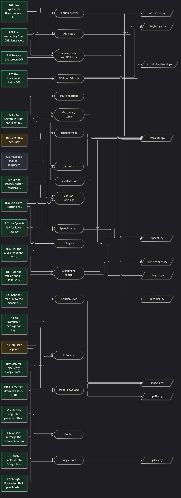

# Live Captions: context graph overview

Requests (left) → features (middle) → main files (right). Full graph: `graph.json`; notes: `vault/`
(open the folder in Obsidian). Green = done, amber = partly done, grey = changed.

Ask it questions: `python context-graph/query.py R21` · `query.py meaning.py` · `query.py --open`

```mermaid
flowchart LR
  R01["R01 Live captions for live streaming in…"]:::done
  R02["R02 Hindi and Punjabi languages"]:::changed
  R03["R03 95 to 100% accuracy"]:::partial
  R04["R04 Only English to Hindi and Hindi to…"]:::done
  R05["R05 Use LocalVocal inside OBS"]:::done
  R06["R06 Pick the audio input and test…"]:::done
  R07["R07 Lower latency, faster captions,…"]:::done
  R08["R08 English to Hinglish and…"]:::done
  R09["R09 Run everything from OBS, language…"]:::done
  R10["R10 Remove the screen OCR"]:::done
  R11["R11 An installable package for any…"]:::done
  R12["R12 Use Qwen3-ASR for lower latency"]:::done
  R13["R13 Write captions into Google Docs"]:::done
  R14["R14 Turn the mic on and off so it isn't…"]:::done
  R15["R15 Intel Mac support"]:::partial
  R16["R16 Step-by-step setup guide for other…"]:::done
  R17["R17 A short message the team can follow"]:::done
  R18["R18 Fix the first download stuck at 0%"]:::done
  R19["R19 DMG for Mac, easy Google Docs,…"]:::done
  R20["R20 Google Docs setup that people who…"]:::done
  R21["R21 Captions that follow the meaning:…"]:::done
  R22["R22 Deliver it with Handy's UI and…"]:::partial
  R23["R23 Choose the transcription and…"]:::done
  R24["R24 Upload song lyrics in any format…"]:::partial
  F_overlay(["Caption overlay"])
  F_dock(["App window and OBS dock"])
  F_obs_setup(["OBS setup"])
  F_speech(["Speech to text"])
  F_whisper_fallback(["Whisper fallback"])
  F_translation(["Translation"])
  F_hinglish(["Hinglish"])
  F_caption_modes(["Caption language"])
  F_caption_styles(["Caption style"])
  F_vocabulary(["Vocabulary terms"])
  F_blocked_words(["Polite captions"])
  F_spelling_fixes(["Spelling fixes"])
  F_mic_control(["Microphone control"])
  F_sessions(["Saved sessions"])
  F_google_docs(["Google Docs"])
  F_model_download(["Model download"])
  F_installers(["Installers"])
  F_desktop_app(["Desktop app"])
  F_dictation(["Dictation"])
  F_custom_words(["Custom words"])
  F_song_mode(["Song mode"])
  F_docs(["Guides"])
  R01 --> F_overlay
  R01 --> F_dock
  R01 --> F_obs_setup
  R02 --> F_caption_modes
  R03 --> F_speech
  R03 --> F_vocabulary
  R03 --> F_spelling_fixes
  R04 --> F_translation
  R04 --> F_vocabulary
  R04 --> F_blocked_words
  R05 --> F_whisper_fallback
  R06 --> F_mic_control
  R06 --> F_speech
  R07 --> F_speech
  R07 --> F_caption_modes
  R07 --> F_translation
  R08 --> F_hinglish
  R08 --> F_caption_modes
  R09 --> F_dock
  R09 --> F_obs_setup
  R10 --> F_dock
  R11 --> F_installers
  R11 --> F_model_download
  R12 --> F_speech
  R13 --> F_google_docs
  R14 --> F_mic_control
  R15 --> F_installers
  R15 --> F_model_download
  R16 --> F_docs
  R17 --> F_docs
  R18 --> F_model_download
  R19 --> F_installers
  R19 --> F_google_docs
  R20 --> F_google_docs
  R21 --> F_caption_styles
  R22 --> F_desktop_app
  R22 --> F_dictation
  R22 --> F_custom_words
  R22 --> F_vocabulary
  R23 --> F_speech
  R23 --> F_translation
  R23 --> F_model_download
  R23 --> F_desktop_app
  R24 --> F_song_mode
  R24 --> F_overlay
  R24 --> F_sessions
  R24 --> F_google_docs
  R24 --> F_desktop_app
  F_overlay --> translator_py[/translator.py/]
  F_dock --> translator_py[/translator.py/]
  F_obs_setup --> obs_setup_py[/obs_setup.py/]
  F_obs_setup --> obs_bridge_py[/obs_bridge.py/]
  F_speech --> qwen_engine_py[/qwen_engine.py/]
  F_speech --> speech_py[/speech.py/]
  F_whisper_fallback --> speech_py[/speech.py/]
  F_whisper_fallback --> obs_bridge_py[/obs_bridge.py/]
  F_whisper_fallback --> install_localvocal_py[/install_localvocal.py/]
  F_translation --> translator_py[/translator.py/]
  F_translation --> translation_py[/translation.py/]
  F_hinglish --> hinglish_py[/hinglish.py/]
  F_hinglish --> translator_py[/translator.py/]
  F_caption_modes --> translator_py[/translator.py/]
  F_caption_styles --> meaning_py[/meaning.py/]
  F_caption_styles --> translator_py[/translator.py/]
  F_caption_styles --> models_py[/models.py/]
  F_vocabulary --> translator_py[/translator.py/]
  F_blocked_words --> translator_py[/translator.py/]
  F_spelling_fixes --> translator_py[/translator.py/]
  F_mic_control --> qwen_engine_py[/qwen_engine.py/]
  F_mic_control --> speech_py[/speech.py/]
  F_sessions --> translator_py[/translator.py/]
  F_google_docs --> gdocs_py[/gdocs.py/]
  F_model_download --> models_py[/models.py/]
  F_model_download --> paths_py[/paths.py/]
  F_desktop_app --> translator_py[/translator.py/]
  F_dictation --> translator_py[/translator.py/]
  F_dictation --> qwen_engine_py[/qwen_engine.py/]
  F_custom_words --> translator_py[/translator.py/]
  F_song_mode --> song_match_py[/song_match.py/]
  F_song_mode --> song_mode_py[/song_mode.py/]
  F_song_mode --> song_library_py[/song_library.py/]
  F_song_mode --> song_import_py[/song_import.py/]
  F_song_mode --> translator_py[/translator.py/]
  F_song_mode --> speech_py[/speech.py/]
  classDef done fill:#173326,stroke:#4cc38a,color:#e8e9ec
  classDef partial fill:#3a2f14,stroke:#f0b54a,color:#e8e9ec
  classDef changed fill:#2e3038,stroke:#9aa0aa,color:#c9ccd3
```

Mermaid source (renders on GitHub)

Picture: `npx @mermaid-js/mermaid-cli -i <the block above> -o context-graph/overview.png -t dark -b '#1e1f24' -s 2`

## Still open

- **R03** 95 to 100% accuracy: About 90% on Oct 30. Qwen3-ASR 1.7B, vocabulary context and spelling fixes raise it; no exact measure yet.
- **R15** Intel Mac support: Built and run under Rosetta; not yet tested on a real Intel Mac.
- **R22** Deliver it with Handy's UI and features (dictation, history, overlay, tray, custom words, models, filler removal, onboarding, themes), without Handy's branding: Fork of Handy in desktop/ (Tauri v2), engine as a helper process. Engine + code tested; not yet tried by a person with a mic, and not in the installers yet.
- **R24** Upload song lyrics in any format (Hindi, English, Punjabi in Devanagari or Roman letters, with translations); recognise the song while it's sung and show each line with its translation in the captions and document; design sprint with approval gates: Design sprint docs/song-mode (Gates 1-5 approved). Concept B: suggest and confirm. Tested on text and on audio through Qwen3 (0 wrong lines); not yet on real singing.

## Not proven yet

- Intel .pkg works: medium: **not yet on a real Intel Mac**
- Windows installer builds: medium: **build checked, install not tested on a real PC by us**
- Setup from source works: high (Mac), untested (Windows)
- First-time download works from zero: high (Mac), **Windows not re-tested**
- Caption styles: speed + quality: high (M4 Pro), **untested on Intel Mac / Windows**
- Engine quits with the desktop app: high (Mac), **Windows untested**
- Desktop app with a real mic + shortcut, typing into another app: untested
- Song mode finds the song and follows lines: medium: **not yet on real singing** ([evidence](song-mode/02-feasibility.md))
- Song uploads and Song mode states: high (code), **not yet used by an operator**

## Size

6 constraints, 22 features, 24 requirements, 39 files, 20 routes, 6 tests, 12 decisions, 22 evidences, 12 releases, 335 links.
