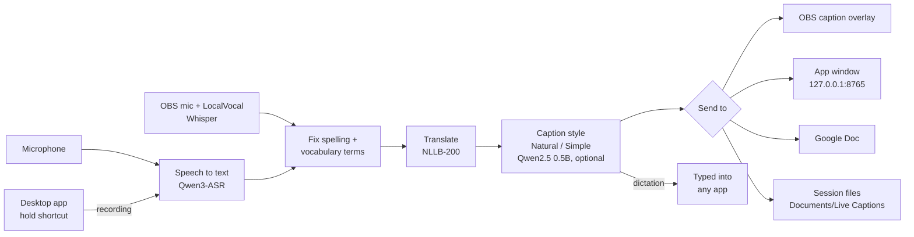
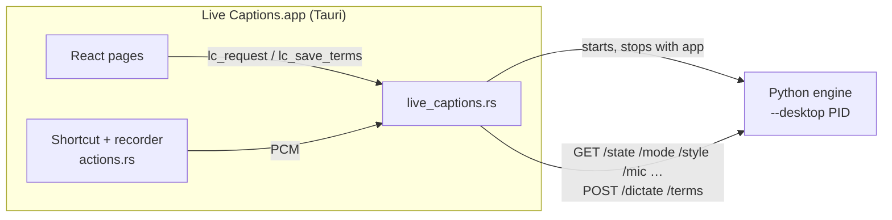

# How Live Captions is built

A map of the project for people and coding agents: what each part does, how the parts
connect, what was decided and why, and what has been tested.

## 1. The big picture

Sound goes in one end and text comes out the other:



Everything in the middle runs on the user's computer. Only the Google Docs part uses the internet,
and it sends text only, never audio.

**Caption styles.** *Word for word* is NLLB's translation as it is. *Natural* and *Simple* add one
step: a small text model rewrites the **English** by meaning (`meaning.py`). It never translates. For a
Hindi speaker it rewrites NLLB's English; for an English speaker with Hindi captions it rewrites the
English first, then NLLB translates that. Each rewrite has 1.5 s (`LIVECAPTIONS_STYLE_SECONDS`) and must
pass checks: no "Here is…", not too long, every vocabulary term, name and number kept, and few new
words. If it fails, that sentence shows word for word. Half sentences and lines of 3 words or fewer
are never rewritten, and neither is a sentence when newer speech is already waiting.

**Desktop app.** `desktop/` is a fork of [Handy](https://github.com/cjpais/Handy) (MIT): a Tauri v2
app (Rust + React) that lives in the menu bar / system tray. It starts the Python engine above as a
helper process (`python -m livecaptions --desktop <app PID>`) and talks to it on 127.0.0.1:8765. Its pages:
*Live Captions* (on/off, language, style, speech model, mic, preview, session, Google Docs, OBS),
*Vocabulary* (custom words), *Dictation* (Handy's push-to-talk, shortcuts, overlay), *History*,
*Models* and *About*. **Dictation**: hold the shortcut, speak, let go. Handy records the clip and
sends it to `POST /dictate`. The engine runs it through the same Qwen3 → vocabulary → NLLB → style steps
as live captions and returns the text, which Handy pastes into the app in front. Handy's own Whisper /
Parakeet models still work if *Speech engine* is set to *Built-in* (Advanced).



## 2. The parts (code files)

All app code is in `app/livecaptions/`. Arrows mean "uses" (taken from the `import` lines):

```mermaid
flowchart TD
    main[__main__.py] --> translator
    translator[translator.py<br/>the hub: pipeline, web server, window] --> speech
    translator --> hinglish[hinglish.py<br/>Hindi ↔ Roman letters]
    translator --> gdocs[gdocs.py<br/>Google Docs sender]
    translator --> obs_setup[obs_setup.py<br/>adds the script to OBS]
    translator --> models
    translator --> translation[translation.py<br/>picks the NLLB size]
    translation --> models
    translator --> meaning[meaning.py<br/>caption styles]
    meaning --> models    translator --> obs_bridge
    speech[speech.py<br/>picks the speech engine] --> qwen[qwen_engine.py<br/>mic + Qwen3-ASR]
    speech --> obs_bridge[obs_bridge.py<br/>talks to OBS / LocalVocal]
    speech --> models
    qwen --> models[models.py<br/>downloads models + PyTorch]
    install_lv[install_localvocal.py<br/>adds the OBS plugin] --> models
    models --> paths[paths.py<br/>where files live]
    obs_bridge --> paths
    gdocs --> paths
    obs_setup --> paths
    install_lv --> paths
```

| File | Job | Change it when… |
|---|---|---|
| `translator.py` | Runs the pipeline. Also serves the window and the OBS dock on port 8765 (`/state`, `/mode`, `/style`, `/speech?model=`, `/translation?model=`, `/models/delete?key=`, `/mic`, `/captions`, `/gdocs`, `/terms`, `/quit`…) and, for the desktop app, `POST /dictate` (one recording → text) and `POST /terms` (custom words → `custom_terms.csv`). POSTs from a web page (`Origin` / `Sec-Fetch-Site` set) are refused. `--desktop PID` = started by the desktop app: no window, quit when that PID ends | the cleanup, translation, or window behaviour changes |
| `meaning.py` | Caption styles *Natural* / *Simple*: prompts, the rewrite with a time limit, and the safety checks that fall back to word for word | style wording, checks, the style model |
| `speech.py` | Chooses Qwen3 (own mic) or LocalVocal (OBS mic), and the Qwen3 size (0.6B default / 1.7B, saved in `speech_model.txt`) | you add a speech engine |
| `translation.py` | The translation model: NLLB-200 600M / 1.3B (default) / 3.3B, saved in `translation_model.txt`. A new choice downloads if missing, then loads in the background and is swapped in; captions keep using the old one until then | you add a translation model |
| `qwen_engine.py` | Opens the mic, detects speech, runs Qwen3-ASR. Turning the mic off closes it for real. `transcribe_clip()` does one dictation recording; a lock keeps it from running at the same time as live captions | mic or speech-model behaviour |
| `models.py` | Downloads the models and installs PyTorch on first start. Intel Macs get PyTorch 2.2.2. If huggingface.co fails it uses the model pack on GitHub (release `models-v1`) or a pack zip found in Downloads/Desktop/Documents. The 1.7B speech model and the 600M / 3.3B translation models download only when chosen (from Hugging Face; no GitHub packs), `delete(key)` removes one (never the defaults or the one in use), and the caption style model (`meaning`, GitHub only) only when Natural/Simple is chosen | model versions, download logic |
| `hinglish.py` | Hindi ↔ Hinglish (Roman letters) spelling | Hinglish spelling |
| `gdocs.py` | Queues lines and sends them to the Google Docs script, retrying when offline | Google Docs sending |
| `song_match.py`, `song_mode.py` | **Song mode** ([design sprint](song-mode/01-requirements.md)). `song_match` compares what was heard with every lyric line in one spelling-proof Roman form (Devanagari and Roman Punjabi/Hindi match), finds the song and follows the line. `song_mode` is the state machine: off → listening → *suggested* ("Sounds like…", the operator taps *Show lyrics*) → *following* (the lyric + its translation replace the caption) ↔ *lost* (normal captions) → listening. Uses the 1.7B speech model while a song is shown, if downloaded | how songs are found or followed |
| `song_library.py`, `song_import.py` | The song library (`~/.livecaptions/songs/library.db`, SQLite; uploaded files kept in `songs/files/`) and reading uploads (.docx, .pdf, .xlsx, .csv, .txt, pasted) into songs, lines and translations. Routes: `/songs`, `/songs/start|confirm|reject|next|back|stop|mode|delete|song|open|example`, `POST /songs/import` (read, nothing saved) and `POST /songs/save` | upload formats, library fields |
| `obs_bridge.py`, `obs_setup.py`, `install_localvocal.py` | OBS: config, the script, the LocalVocal plugin | OBS integration |
| `paths.py` | Every folder the app uses | never, unless a folder moves |
| `dock.html`, `data/overlay.html` | The window/dock page, and the on-stream caption overlay | how they look |
| `data/vocabulary/` | The vocabulary sheet, Hindi terms, blocked words, Hinglish lexicon | **the vocabulary** (Excel sheet; changes apply live) |
| `~/.livecaptions/custom_terms.csv` | Words added on the desktop app's Vocabulary page (term, English meaning, Hindi spelling). They win over the sheet | through the app, not by hand |
| `data/google-docs/oauth_client.json` | Google sign-in client (added by CI from a secret, not in git) | Sign in with Google |

Outside the app:

| Folder | Job |
|---|---|
| `desktop/` | The desktop app (Handy fork, Tauri v2). Build: `cd desktop && bun install && bun run tauri build` (needs Rust, Bun, CMake). Dev: `bun run tauri dev` |
| `desktop/src-tauri/src/live_captions.rs` | Finds Python (`LIVECAPTIONS_HOME`, the app's Resources, this source checkout's `.venv`, or an installed Live Captions), starts/stops the engine, and the `lc_request` (GET routes in `ALLOWED`), `lc_post` (`ALLOWED_POST`: song import/save), `lc_save_terms`, `lc_links` commands; `dictate()` for push-to-talk |
| `desktop/src-tauri/src/actions.rs`, `settings.rs` | Handy's recorder → our engine when `speech_engine = live_captions` (default); `built_in` uses Handy's models. Updater is off unless `LIVECAPTIONS_ENABLE_UPDATER` is set |
| `desktop/src/components/speech/EngineModelTable.tsx` | The *Transcription* (Qwen3) and *Translation* (NLLB) tables on the Models page, in Handy's `ModelTableRow` look: click to download or load, trash to delete (asks first). |
| `desktop/src/components/speech/SpeechModels.tsx` | The one-line speech-model summary on the Live Captions page and footer. Handy's type-only models sit folded under it ("Dictation without translation"); its switch sets `speech_engine` |
| `desktop/src/components/settings/live/` | The *Live Captions* and *Vocabulary* pages; `desktop/src/hooks/useEngine.ts` reads `/state` |
| `desktop/src/components/songs/` | Song mode: the *Songs* page (library, upload, search, delete), the *Check the songs* step (`CheckSongs.tsx`), and the *Now singing* card/bar on the Live Captions page (`NowSinging.tsx`, keys ← → Esc) |
| `desktop/src/i18n/locales/` | UI text in 26 languages (also builds the tray menu text) |
| `obs/live_captions.lua` | The OBS script. It starts the app with OBS and adds the overlay. It looks for Python next to itself (installed) or in `.venv` (source) |
| `installer/macos/` | Builds the `.pkg`/`.dmg`. `ARCH=arm64` or `ARCH=x86_64`. By default `Live Captions.app` is the desktop app with `Resources/{python,app,obs}` inside; `DESKTOP=0` = old launcher |
| `installer/windows/` | Builds `Setup.exe` (Inno Setup). By default installs `live-captions.exe` + `resources\` next to `python\` and `app\`; `$env:DESKTOP="0"` = old launcher |
| `.github/workflows/build.yml` | On a `v*` tag: builds both Mac packages and the Windows installer (with Rust, Bun, CMake / Vulkan SDK for the desktop app), then publishes a release |
| `tests/` | `test_vocabulary.py` (every term, every mode), `test_meaning.py` (caption-style fallbacks, no model needed), `bench_meaning.py` (style model speed test), `test_qwen_live.py` (speech), `test_gdocs_script.py` |
| `docs/` | User guides (install, setup, Google Docs) and this map |
| `context-graph/` | Every user request linked to the features, files, routes, tests, decisions and evidence behind it. `requirements.py` (edit by hand) → `build.py` → `graph.json`, `vault/` (Obsidian), `OVERVIEW.md`; ask it with `query.py` |

## 3. Where things are kept on a computer

| What | Where | Delete it and… |
|---|---|---|
| Models (~8 GB) | `~/.livecaptions/models/` | they download again |
| PyTorch + speech packages | `~/.livecaptions/pylib/` | they install again on next start |
| Settings, log, PID, custom words | `~/.livecaptions/` (`translator.log`, `custom_terms.csv`) | settings go back to default; custom words are gone |
| Desktop app settings, dictation history + recordings | Mac: `~/Library/Application Support/org.livecaptions.obs/` · Windows: `%APPDATA%\org.livecaptions.obs` | history is gone |
| Saved sessions | `Documents/Live Captions/` | your transcripts are gone (keep a copy) |
| Installed app | Mac: `/Applications/Live Captions.app` · Windows: `%LOCALAPPDATA%\Programs\Live Captions` | reinstall |

On Windows `~` means `%USERPROFILE%`. Tests can point `LIVECAPTIONS_DATA` and
`LIVECAPTIONS_SESSIONS` at temporary folders.

## 4. Decisions and why

| Decision | Why | Revisit when |
|---|---|---|
| Qwen3-ASR for speech | Best Hindi + English accuracy in our tests; 0.6B is fast, 1.7B more accurate | a better offline Hindi model appears |
| NLLB-200 (CTranslate2, int8) for translation | Offline, good Hindi ↔ English, small | licence needs change (NLLB is non-commercial) |
| Caption styles: Qwen2.5-0.5B-Instruct (CTranslate2 int8) rewrites English only, greedy, 1.5 s limit | Speed test on 30 real lines (M4 Pro): 0.5B median 0.5 s Natural / 0.4 s Simple, never over 1.5 s; 1.5B was nicer but median 1.4 s with 12/30 Natural over 1.5 s. Qwen3-1.7B: fewest rejections but median 1.7 s, 23/30 Natural over 1.5 s. The small model sometimes changes the meaning, so strict checks fall back to word for word | a faster computer target, or the checks reject too often: try 1.5B (`tests/bench_meaning.py`) |
| PyTorch is downloaded on first start, not bundled | Keeps installers under 70 MB; picks the GPU build on NVIDIA PCs | never, unless offline installs are needed |
| Intel Macs pinned to PyTorch 2.2.2 + NumPy 1.x, CPU only | 2.2.2 is the last Intel Mac build | if Intel support is dropped |
| Intel `.pkg` built on Apple Silicon via Rosetta | GitHub is retiring its Intel Mac machines | if the Rosetta build breaks |
| The window is a local web page | Works the same on Mac, Windows and inside OBS; no UI toolkit to install | never |
| Google Docs two ways: **Way 1** (default) a script in the doc, pasted Web app URL; **Way 2** Sign in with Google (OAuth desktop + PKCE, scope drive.file) and the Docs API | Way 1 needs no Google Cloud project and no test list, so anyone can do it; the window names the fix for every wrong paste or deployment setting (the old sidebar link broke with "page not found"). Way 2 makes a new doc per session but the Gmail must be on the test list | if many users outside the test list want Way 2: publish the app |
| Desktop app = fork of Handy (Tauri v2), engine stays in Python | The user asked for Handy's UI and features (dictation, history, overlay, tray, onboarding, themes) with our pipeline. Rewriting Qwen3 + NLLB + vocabulary + styles in Rust would have duplicated tested code; a local helper process keeps one pipeline for OBS, the window and dictation | if the Python install becomes the main support problem |
| Dictation goes through `/dictate`, not Handy's Whisper | Same vocabulary, translation and caption style as the captions; Hindi → English while dictating. Handy's models kept as *Built-in* fallback | — |
| Handy branding removed; MIT credit kept in About, `THIRD_PARTY.md` and `desktop/LICENSE` | User asked to remove the branding; the MIT licence requires the notice | never drop the notice |
| Not signed by Apple/Microsoft | Signing costs money every year; the guide explains the one-time prompt | if many users get stuck on the prompt |

## 5. What has been tested (and what hasn't)

| Claim | How it was checked | Date | Confidence |
|---|---|---|---|
| Apple Silicon `.pkg` installs and runs | Installed on an M-series Mac, live OBS test | Oct 2026 | high |
| Intel `.pkg` works | Ran the packaged Intel Python under Rosetta: speech engine install, Hindi test clip, translation | Oct 2026 | medium: **not yet on a real Intel Mac** |
| Windows installer builds | GitHub Actions builds it on every release | Oct 2026 | medium: **build checked, install not tested on a real PC by us** |
| Setup from source works | Fresh `git clone`, `.venv`, `pip install`, `--test` on a Mac | Oct 2026 | high (Mac), untested (Windows) |
| Mic off releases the microphone | Log shows "Microphone released"; macOS mic dot goes off | Oct 2026 | high |
| First-time download works from zero | Empty data folder, plain HTTPS (Xet off): 0 → 100% for NLLB in ~90 s on a Mac | Oct 31 2026 | high (Mac), **Windows not re-tested** |
| Blocked network fails clearly instead of hanging | Pointed the download at an unreachable address: stops after ~100 s with "huggingface.co can't be reached…" + Try again (before: waited forever at 0%) | Oct 31 2026 | high |
| Offline pack installs with no Hugging Face | Fresh home folder, zips in Downloads, Hugging Face blocked: both models ready in 3 s, translation + Hindi transcription correct | Oct 31 2026 | high (Mac) |
| GitHub fallback when Hugging Face fails | Hugging Face blocked: NLLB installed from the real GitHub pack in 14 min, progress moving, no leftovers; a zip with a `../` path is rejected | Oct 31 2026 | high (Mac) |
| Vocabulary terms survive translation | `tests/test_vocabulary.py` | each change | high |
| Caption styles fall back safely (late, too long, "Here is", dropped/added term, changed number, new ideas) | `tests/test_meaning.py` with a fake model | Nov 1 2026 | high |
| Caption styles: speed + quality | `tests/bench_meaning.py`, 30 real lines, M4 Pro: Natural median 0.51 s, Simple 0.38 s; checks rejected 3 / 8 of 30 (shown word for word) | Nov 1 2026 | high (M4 Pro), **untested on Intel Mac / Windows** |
| Style model downloads on first use | Fresh data folder: `meaning` pack from GitHub in ~35 s, loads in 0.3 s; window shows downloading → ready | Nov 1 2026 | high (Mac) |

| Dictation endpoint | Engine started with `--desktop PID`; macOS voice clip *"आज हम सब मिलकर सत्संग में सेवा करेंगे"* → `POST /dictate` → *"…sewa (selfless service) in satsang…"* in 1.6 s (1.7B, M-series) | Nov 3 2026 | high (Mac) |
| Custom words apply to dictation | `POST /terms` *Burari = Samagam ground in Delhi* → next dictation *"Burari (Samagam ground in Delhi) ground"*; removed again | Nov 3 2026 | high |
| Web pages can't post to the engine | `POST /dictate` with `Origin` + `Sec-Fetch-Site: cross-site` → 403 | Nov 3 2026 | high |
| Engine quits with the desktop app | Killed the `--desktop` parent PID → log *Desktop app closed: stopping*, no process left | Nov 3 2026 | high (Mac), **Windows untested** |
| Desktop app code | `cargo test --lib` 338 passed; `tsc`, `eslint`, keyboard test pass | Nov 3 2026 | high |
| Mac installer contains the desktop app | `ARCH=arm64 installer/macos/build.sh`: 60 MB `.pkg`; the app inside started the engine from its own `Resources/python` (not `.venv`), model ready, `/dictate` Hindi clip → *"…sewa (selfless service) in satsang…"* | Nov 3 2026 | high (Apple Silicon), **Intel and Windows installers not built yet** |
| Desktop app with a real mic + shortcut, typing into another app | **not yet tested by a person** (needs mic + Accessibility permission) | — | untested |
| Song mode finds the song and follows lines | `tests/test_songs.py --audio qwen-1.7b`: 8 songs (Hindi, Punjabi Roman + Devanagari, English, decoy, mid-song start, chorus), Mac voice + drone + echo through Qwen3: found within 2 lines, **0 wrong lines**, unknown song never shown; 0.6B weaker on Punjabi Devanagari | Nov 3 2026 | medium: **not yet on real singing** ([evidence](song-mode/02-feasibility.md)) |
| Song uploads and Song mode states | `tests/test_songs.py`: paste, Excel, CSV, Word, scanned PDF message, .doc hint; suggest → confirm → follow → lost → found again → song over; Not this; off | Nov 3 2026 | high (code), **not yet used by an operator** |

When you test something new, add a row. Results get stale: re-test after big updates
(new PyTorch, new models, new OS version).
