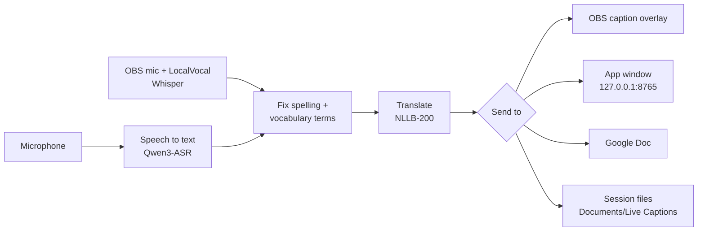
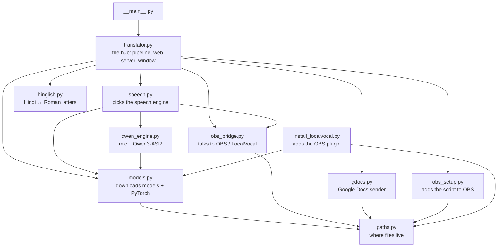

# How Live Captions is built

A map of the project for people and coding agents: what each part does, how the parts
connect, what was decided and why, and what has been tested.

## 1. The big picture

Sound goes in one end and text comes out the other:

Everything in the middle runs on the user's computer. Only the Google Docs part uses the internet,
and it sends text only, never audio.

## 2. The parts (code files)

All app code is in `app/livecaptions/`. Arrows mean "uses" (taken from the `import` lines):

| File | Job | Change it when… |
|---|---|---|
| `translator.py` | Runs the pipeline. Also serves the window and the OBS dock on port 8765 (`/state`, `/mode`, `/mic`, `/captions`, `/gdocs`, `/quit`…) | the cleanup, translation, or window behaviour changes |
| `speech.py` | Chooses Qwen3 (own mic) or LocalVocal (OBS mic) | you add a speech engine |
| `qwen_engine.py` | Opens the mic, detects speech, runs Qwen3-ASR. Turning the mic off closes it for real | mic or speech-model behaviour |
| `models.py` | Downloads the models and installs PyTorch on first start. Intel Macs get PyTorch 2.2.2 | model versions, download logic |
| `hinglish.py` | Hindi ↔ Hinglish (Roman letters) spelling | Hinglish spelling |
| `gdocs.py` | Queues lines and sends them to the Google Docs script, retrying when offline | Google Docs sending |
| `obs_bridge.py`, `obs_setup.py`, `install_localvocal.py` | OBS: config, the script, the LocalVocal plugin | OBS integration |
| `paths.py` | Every folder the app uses | never, unless a folder moves |
| `dock.html`, `data/overlay.html` | The window/dock page, and the on-stream caption overlay | how they look |
| `data/vocabulary/` | The vocabulary sheet, Hindi terms, blocked words, Hinglish lexicon | **the vocabulary** (Excel sheet; changes apply live) |
| `data/google-docs/LiveCaptions.gs` | The script pasted into a Google Doc | the Google Docs sidebar |

Outside the app:

| Folder | Job |
|---|---|
| `obs/live_captions.lua` | The OBS script. It starts the app with OBS and adds the overlay. It looks for Python next to itself (installed) or in `.venv` (source) |
| `installer/macos/` | Builds the `.pkg`. `ARCH=arm64` or `ARCH=x86_64` |
| `installer/windows/` | Builds `Setup.exe` (Inno Setup) |
| `.github/workflows/build.yml` | On a `v*` tag: builds both Mac packages and the Windows installer, then publishes a release |
| `tests/` | `test_vocabulary.py` (every term, every mode), `test_qwen_live.py` (speech) |
| `docs/` | User guides (install, setup, Google Docs) and this map |

## 3. Where things are kept on a computer

| What | Where | Delete it and… |
|---|---|---|
| Models (~8 GB) | `~/.livecaptions/models/` | they download again |
| PyTorch + speech packages | `~/.livecaptions/pylib/` | they install again on next start |
| Settings, log, PID | `~/.livecaptions/` (`translator.log`) | settings go back to default |
| Saved sessions | `Documents/Live Captions/` | your transcripts are gone (keep a copy) |
| Installed app | Mac: `/Applications/Live Captions.app` · Windows: `%LOCALAPPDATA%\Programs\Live Captions` | reinstall |

On Windows `~` means `%USERPROFILE%`. Tests can point `LIVECAPTIONS_DATA` and
`LIVECAPTIONS_SESSIONS` at temporary folders.

## 4. Decisions and why

| Decision | Why | Revisit when |
|---|---|---|
| Qwen3-ASR for speech | Best Hindi + English accuracy in our tests; 0.6B is fast, 1.7B more accurate | a better offline Hindi model appears |
| NLLB-200 (CTranslate2, int8) for translation | Offline, good Hindi ↔ English, small | licence needs change (NLLB is non-commercial) |
| PyTorch is downloaded on first start, not bundled | Keeps installers under 70 MB; picks the GPU build on NVIDIA PCs | never, unless offline installs are needed |
| Intel Macs pinned to PyTorch 2.2.2 + NumPy 1.x, CPU only | 2.2.2 is the last Intel Mac build | if Intel support is dropped |
| Intel `.pkg` built on Apple Silicon via Rosetta | GitHub is retiring its Intel Mac machines | if the Rosetta build breaks |
| The window is a local web page | Works the same on Mac, Windows and inside OBS; no UI toolkit to install | never |
| Google Docs through an Apps Script web app with a secret key | A browser page can't talk to a local app; the key stops others writing | if Google changes Apps Script |
| Not signed by Apple/Microsoft | Signing costs money every year; the guide explains the one-time prompt | if many users get stuck on the prompt |

## 5. What has been tested (and what hasn't)

| Claim | How it was checked | Date | Confidence |
|---|---|---|---|
| Apple Silicon `.pkg` installs and runs | Installed on an M-series Mac, live OBS test | Oct 2026 | high |
| Intel `.pkg` works | Ran the packaged Intel Python under Rosetta: speech engine install, Hindi test clip, translation | Oct 2026 | medium: **not yet on a real Intel Mac** |
| Windows installer builds | GitHub Actions builds it on every release | Oct 2026 | medium: **build checked, install not tested on a real PC by us** |
| Setup from source works | Fresh `git clone`, `.venv`, `pip install`, `--test` on a Mac | Oct 2026 | high (Mac), untested (Windows) |
| Mic off releases the microphone | Log shows "Microphone released"; macOS mic dot goes off | Oct 2026 | high |
| First-time download works from zero | Empty data folder, plain HTTPS (Xet off): 0 → 100% for NLLB in ~90 s on a Mac | Oct 31 2026 | high (Mac), **Windows not re-tested** |
| Blocked network fails clearly instead of hanging | Pointed the download at an unreachable address: stops after ~100 s with "huggingface.co can't be reached…" + Try again (before: waited forever at 0%) | Oct 31 2026 | high |
| Vocabulary terms survive translation | `tests/test_vocabulary.py` | each change | high |

When you test something new, add a row. Results get stale: re-test after big updates
(new PyTorch, new models, new OS version).
