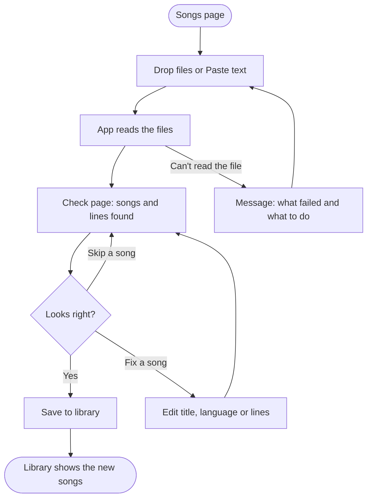
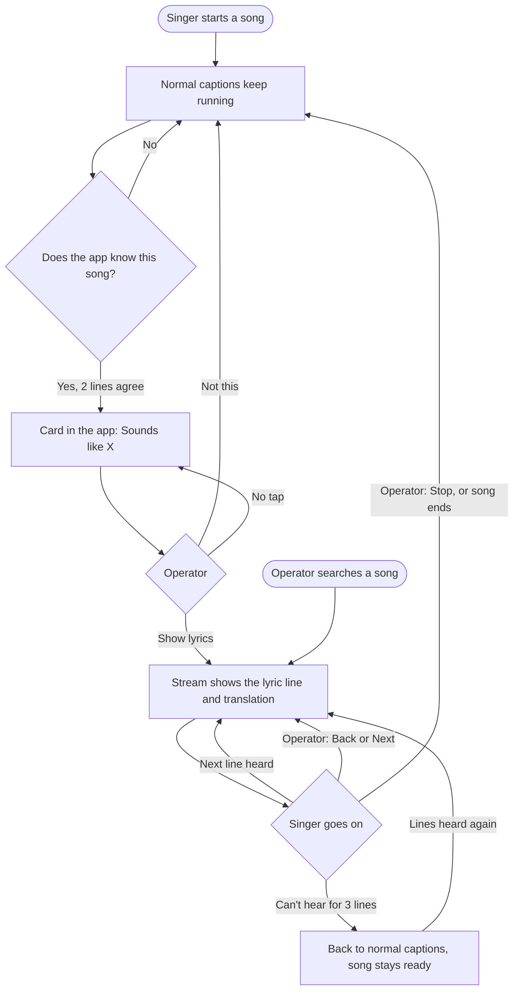

# Song mode: prototype spec (Day 3)

Status: **Approved** (Gate 4, 2026-11-03).
Concept: **B, suggest and confirm** (Gate 3). Model: 1.7B for songs if downloaded (Gate 2).

## 1. Flows

### Flow 1: add songs (librarian)



### Flow 2: a song during satsang (operator)



## 2. State machine (Song mode)

One state at a time. Every state has a way out, and none of them can block the captions.

| State | What the stream shows | What the app shows | Leaves on |
|---|---|---|---|
| **Off** | normal captions | "Songs: off" switch | operator turns on → *Listening* |
| **Listening** | normal captions | small "Listening for songs" | 2 heard pieces agree on one song, or 1 very close → *Suggested* · operator starts a song → *Following* |
| **Suggested** (song X, line N) | normal captions | card: *Sounds like X* + [Show lyrics] [Not this] + the line it heard | "Show lyrics" → *Following* (line N) · "Not this" → *Listening* (X ignored for 2 min) · 45 s with no tap → *Listening* |
| **Following** (X, line N) | lyric line N + translation | Now singing bar: X, line N of M, next line greyed, [Back] [Next] [Stop] | heard next line → line N+1 · Back or Next → N±1 · 3 misses → *Lost* · Stop, or the last line + 8 s quiet → *Listening* |
| **Lost** (X, last line N) | normal captions | bar: "Can't hear the song: showing normal captions" + [Next] [Stop] | heard a line of X → *Following* · Next → *Following* N+1 · 60 s → *Listening* |

Guards and rules:
- Only *Following* puts lyrics on the stream. *Suggested* never does (concept B).
- Songs the operator said "Not this" to aren't suggested again for 2 minutes.
- Moving into *Following* switches speech to 1.7B, if it's downloaded. Leaving Song mode puts back the model that was chosen.
- States that can't happen: lyrics and normal captions together (Q1: the lyric replaces), or two songs at once.

## 3. Screens (wireframes)

The app's existing look: the Handy layout, Royal Blue, the same row and button styles as the Vocabulary and Models pages.

### 3a. Songs page (new sidebar item, under Vocabulary)

```
┌─ Songs ──────────────────────────────────────────────────────────┐
│ Songs show the real lyrics and their translation on the stream   │
│ while they're sung.                                              │
│                                                                  │
│ [ Song mode  ●━ on ]   Listens for songs in your library.        │
│                                                                  │
│ ┌ Add songs ───────────────────────────────────────────────────┐ │
│ │   Drop Word, PDF, Excel or text files here                   │ │
│ │   [ Choose files ]   [ Paste lyrics ]                        │ │
│ │   Tip: put the translation on the line under each line,      │ │
│ │   or in the next column in Excel.                            │ │
│ └──────────────────────────────────────────────────────────────┘ │
│                                                                  │
│ [ Search songs…                                ]  24 songs       │
│ ─────────────────────────────────────────────────────────────── │
│ Man Mein Tera Naam        Hindi    8 lines   English  [▶] [🗑]  │
│ Tera Shukar Data          Punjabi  7 lines   En, Hi   [▶] [🗑]  │
│ O Formless One            English  4 lines   Hindi    [▶] [🗑]  │
└──────────────────────────────────────────────────────────────────┘
```
- **[▶] Start:** starts this song now, the manual path (*Following* from line 1).
- **[🗑] Delete:** asks first: *"Delete Man Mein Tera Naam? [Cancel] [Delete]"*.
- **Click a row:** opens the song: all lines, with each translation under its line, editable.
- **Empty state:** *"No songs yet. Drop a file with lyrics to start."*

### 3b. Check page (after a file is read)

```
┌─ Check the songs ────────────────────────────────────────────────┐
│ Found 3 songs in bhajans.docx                                    │
│                                                                  │
│ ✓ Man Mein Tera Naam   Hindi ▾   8 lines · English for 8 of 8    │
│   मन में तेरा नाम बसा है                                          │
│   Your name lives in my heart                                    │
│   … [Show all lines]                                             │
│ ✓ Tera Shukar Data     Punjabi ▾ 7 lines · English for 7 of 7    │
│ ! Untitled song 3      Hindi ▾   5 lines · no translation        │
│   [Edit]  [Skip]                                                 │
│                                                                  │
│                         [ Cancel ]   [ Save 3 songs ]            │
└──────────────────────────────────────────────────────────────────┘
```
- "!" marks a song that needs a look (no title, no translation, or very short), but it can still be saved.
- The language is guessed from the script and words, and can be changed.

### 3c. Live Captions page: the song card and the Now singing bar

**Suggested:**
```
┌──────────────────────────────────────────────────────────────────┐
│ ♪ Sounds like  Man Mein Tera Naam                                │
│   heard: "मन में तेरा नाम बसा है"                                  │
│                      [ Not this ]   [ Show lyrics ]  ← primary   │
└──────────────────────────────────────────────────────────────────┘
```

**Following:**
```
┌──────────────────────────────────────────────────────────────────┐
│ ♪ Man Mein Tera Naam · line 3 of 8                    [ Stop ]   │
│   सत्संग में जो आया है                                            │
│   Whoever has come to the satsang                                │
│   next: उसका जीवन धन्य हुआ                     (greyed)           │
│                         [ ← Back ]   [ Next → ]                  │
└──────────────────────────────────────────────────────────────────┘
```
- **Keys:** ← and → for Back and Next, Esc for Stop. Big buttons, at least 36 px tall, so they're easy to hit in a hurry.
- **Lost:** the bar turns amber: *"Can't hear the song: showing normal captions."*
- **Also shown in the footer:** a small "♪ Man Mein Tera Naam" when the operator is on another page, and clicking it opens the bar.

### 3d. Stream overlay

```
              ┌──────────────────────────────────┐
              │   सत्संग में जो आया है             │   ← line, full size
              │   Whoever has come to the satsang │   ← translation, 80% size, lighter
              └──────────────────────────────────┘
```
- At most **2 lines**: the lyric and its translation. Long lines wrap at about 42 characters.
- A line stays on screen until the next line comes. No flicker between lines: a 250 ms fade.
- No translation for a line → only the lyric.
- The translation follows the caption language you chose (Q2). For example, "Hindi → English" shows the English one. If the song has no translation in that language, only the lyric shows.

### 3e. Document and saved sessions

- A song is written as one block, marked:
  `♪ Man Mein Tera Naam` and then each line sung, with its translation, in the same style as the captions.
- Only lines that were shown on the stream are written, so what's in the document matches the stream.

## 4. What files are understood (the "any format" rule)

The app splits files into songs and lines the same way, whatever the file type.
- **Excel / CSV:** columns *Title*, *Line*, *English*, *Hindi* (any order, names in English or Hindi). Without headers: column 1 is the line, column 2 the translation, and a blank row starts a new song.
- **Word / text / pasted:**
  - A new song starts at a title line (bold or heading in Word, or a line followed by a blank line and then lyrics), or at a blank line pair.
  - A line in a different script or language right under a lyric line is its translation, for example Devanagari, then English. "English:" or "Hindi:" in front also works.
- **PDF:** the text is taken out and handled like Word. Scanned PDFs (pictures) can't be read, and the message says so.
- **The original file is always kept** in the library folder.

## 5. Words (plain language, about grade 6 for buttons, grade 8 for help)

| Place | Text |
|---|---|
| Page title | Songs |
| Page help | Songs show the real lyrics and their translation on the stream while they're sung. |
| Switch | Song mode · Listens for songs in your library. |
| Drop area | Drop Word, PDF, Excel or text files here |
| Buttons | Choose files · Paste lyrics · Save 3 songs · Cancel · Skip · Edit |
| Tip | Put the translation on the line under each line, or in the next column in Excel. |
| Card | Sounds like **{song}** · Show lyrics · Not this |
| Bar | Line {n} of {m} · Back · Next · Stop |
| Lost | Can't hear the song: showing normal captions. |
| Empty | No songs yet. Drop a file with lyrics to start. |
| Bad file | Couldn't read {file}. If it's a scanned PDF, copy the text into Paste lyrics. |
| No lines | No lyrics found in {file}. Each line of a song should be on its own line. |
| Delete | Delete {song}? · Cancel · Delete |

## 6. Accessibility notes

- **Captions on the stream:** at most 2 lines, about 42 characters per line, the same high-contrast box as today. Each line stays at least 1.5 s, even if the singer is quick.
- **Keyboard:** everything in the bar works by keyboard: ← → Esc, and Tab order Back, Next, Stop. The card's primary button gets focus without stealing it from a text field.
- **Colour:** status is never shown by colour alone. *Lost* has words as well as amber.
- **Screen readers:** the card is announced politely ("Sounds like Man Mein Tera Naam").
- **Motion:** the fade is off when Reduce Motion is on.

## 7. Interactive mock

The build stage makes the real screens from this spec. Before building, here is a click-through of the three key moments (Suggested → Following → Lost), as states of one component, so you can judge the flow in the real app style. It's checked in the Test stage.
